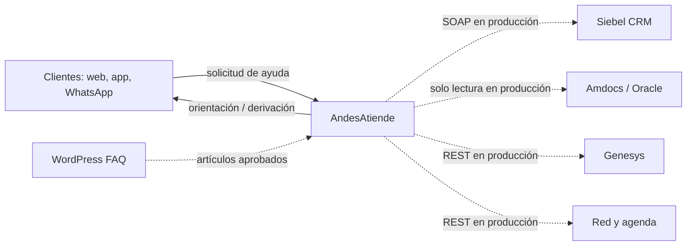
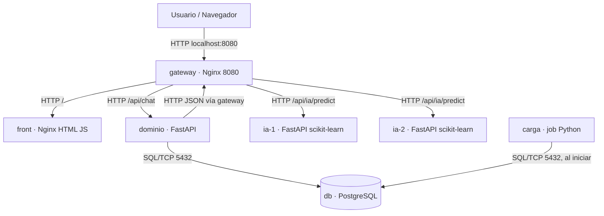
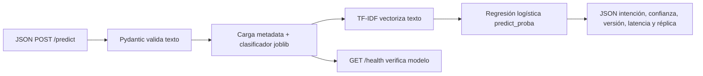
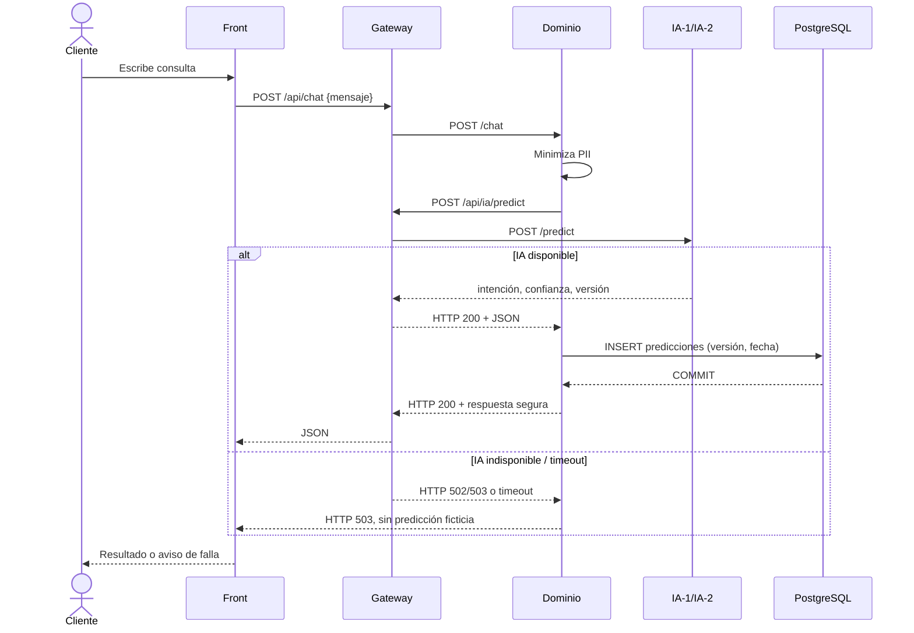
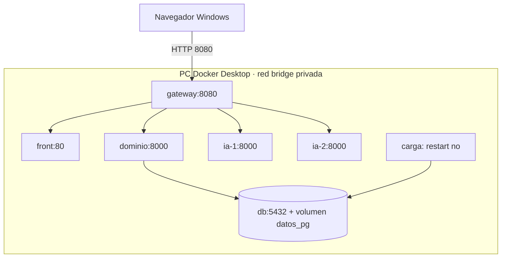
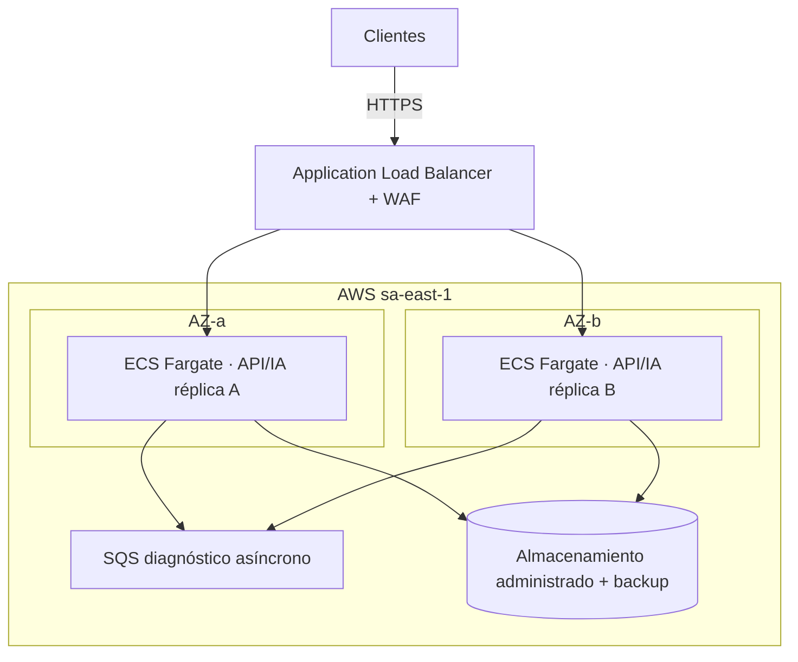
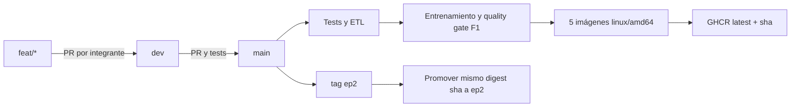
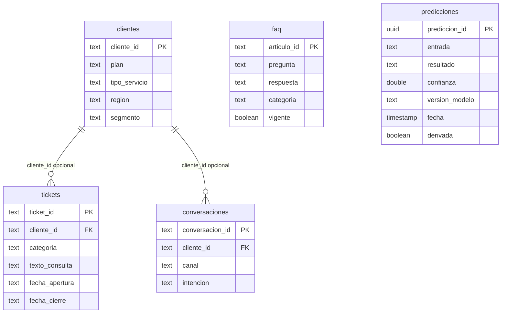

# Evaluación Parcial 2 · arc42 AndesAtiende (BORRADOR DE TRABAJO)

**ITY1102 · Equipo 05 · Sangster–Llauri · Caso 2 Andesnet.**
**No subir directamente a AVA:** debe adaptarse al arc42 de EP1, convertirse en PDF y completar los campos **[MEDIR]**, **[VERIFICAR]**, **[ENLACE]** y las firmas. Los gráficos están en Mermaid para versionarlos en GitHub. Los límites de recursos actuales son hipótesis.

## Historial de versiones

| Fecha | Versión | Responsable | Cambios |
|---|---|---|---|
| 13-09-2026 | 1.0 | Equipo 05 | Diseño EP1: contexto, requisitos, costos y decisiones |
| 18-10-2026 | 2.0-borrador | Equipo 05 | Extensión a contenedores C4, componentes, secuencia, ETL y código inicial; validar feedback EP1 |

## 1. Introducción y objetivos

AndesAtiende es un asistente de texto para usuarios de telecomunicaciones que identifica la intención y orienta su siguiente paso. El problema original presenta 340.000 contactos/mes, 80% de consultas repetitivas y una espera de 8 min 10 s. Para producción, RNF1 exige latencia p95 menor a tres segundos; RNF2, 99,5% de disponibilidad mensual; RNF3, 1.000 conversaciones simultáneas; RNF10, como máximo 20 llamadas en paralelo del bot a Siebel. El piloto del 10% debe estar operativo a las veinte semanas y mantenerse ocho semanas antes de ampliar (RO3).

**Diferencia entre versiones:** en EP2 se desarrolla una prueba de extremo a extremo local con clasificación de intenciones, base y persistencia. No sustituye el orquestador productivo, RAG, Bedrock, mTLS ni integraciones reales de CRM, facturación o canales.

## 2. Restricciones

Se conservan los códigos originales: RT1/RT2 (AWS habilitada y USD 8.500/mes), RT3 (Siebel SOAP 40 concurrentes, 20 reservadas para bot por RNF10), RT4 (Oracle solo lectura), RT5/RT6 (Infobip y Angular 14), RT8 (comunicación cifrada y autenticada), RO3 (piloto ocho semanas), RN1/RN2/RN6 (privacidad y retención). El HTTP sin TLS entre contenedores es una excepción del prototipo EP2, no cumplimiento productivo de RT8.

## 3. Alcance y contexto del sistema

**Figura 1 · Contexto empresarial (actualización EP1).**

La línea discontinua indica integraciones **propuestas, no implementadas** en EP2. Los canales web, móvil y WhatsApp no se rediseñan como parte del proyecto; la demo presenta solo un frontend web.

### 3.2 Contexto técnico

El navegador consume `GET /` y `POST /api/chat` mediante HTTP local. Nginx enruta a FastAPI-dominio y balancea `POST /api/ia/predict` entre dos procesos de inferencia. Para producción se requieren HTTPS/OIDC, SOAP Siebel, acceso Oracle de lectura, REST Genesys e Infobip; esos contratos son externos al prototipo local.

## 4. Estrategia de solución

Se adoptan los patrones **API Gateway** y **microservicios por responsabilidad**. El primero crea un punto de entrada y balanceo; el segundo separa clasificación estadística de persistencia. El contenedor de carga inicial implementa **job idempotente**. Para AWS se mantiene la decisión EP1 de procesamiento orientado a eventos: SQS/worker para diagnósticos que tardan 4–20 s y un semáforo global que no exceda 20 peticiones Siebel simultáneas. **SQS no existe en el compose de EP2 y no debe dibujarse como servicio local.**

## 5. Vista de bloques de construcción

### 5.1 Nivel 1

Las responsabilidades generales permanecen alineadas con EP1: UI, entrada API, dominio, IA y datos. Se añade el job de carga inicial que alimenta datos reales limpios.

### 5.2 Nivel 2 · Contenedores

**Figura 2 · C4 nivel 2 · Servicios exactos del compose.yaml.**

Todas las imágenes propias son `ghcr.io/<owner>/andesatiende-<servicio>:ep2` y se publican desde GitHub Actions. Las dos réplicas de IA reutilizan una misma imagen. Nginx es el único contenedor con `ports: 8080:8080`.

### 5.3 Nivel 3 · Componentes del servicio de IA

**Figura 3 · C4 nivel 3 · FastAPI / modelo serializado.**

El framework es scikit-learn. El servicio no conoce credenciales de DB ni realiza operaciones de negocio. La API de dominio registra la predicción al recibir la respuesta del modelo.

## 6. Vista en tiempo de ejecución

**Figura 4 · Secuencia principal y degradación por falla.**

Al detener una réplica, la upstream de Nginx puede continuar con la otra; no se garantiza que una petición ya en vuelo no falle. El cliente puede reintentar sin implicar alta disponibilidad del stack completo.

## 7. Vista de implementación

### 7.1 Arquitectura actual y objetivo

**Figura 5 · Despliegue actual (Docker Compose local).**

**Figura 6 · Despliegue AWS propuesto, no desplegado en EP2.**

Para producción se requieren ALB health checks, configuración de reintentos, despliegue multi-AZ, aislamiento de credenciales, validación RTO/RPO y tests de carga; ninguna de esas propiedades queda demostrada por Compose local.

### 7.2 Dimensionamiento inicial (SUJETO A MEDICIÓN)

| Servicio | Límite CPU Compose | Límite RAM Compose | Justificación actual |
|---|---:|---:|---|
| gateway | 0,50 CPU | 64 MiB | Hipótesis; medir con docker stats |
| front | 0,25 CPU | 64 MiB | Hipótesis; medir |
| dominio | 0,75 CPU | 256 MiB | Hipótesis; medir |
| ia-1 / ia-2 | 0,75 CPU cada una | 384 MiB cada una | Hipótesis; medir 100 peticiones |
| carga | 0,50 CPU | 128 MiB | Job finito; validar pico |
| db | 0,75 CPU | 384 MiB | Hipótesis; validar picos |

**[MEDIR]:** ejecutar `python scripts/probar_carga.py --n 100`, `docker stats`, informar máximos reales (MiB/CPU) y margen elegido. Si existe OOM, revisar recursos y reentrenar o ajustar carga. No escribir que se cumplió RNF3 sin prueba de 1.000 conversaciones.

### 7.3 Costo AWS

El informe EP1 proyectó USD 1.512/mes para el piloto y USD 5.656/mes a escala completa; **son cifras del diseño anterior, no una cotización comprobada de EP2**. **[VERIFICAR]:** usar calculadora AWS actual y alinear la infraestructura objetivo a lo descrito en figura 6. Desglosar Fargate, ALB/WAF, bases, red/NAT, SQS, logging, backups y consumo IA; comprobar total menor a RT2, USD 8.500/mes, e indicar las exclusiones contractuales del caso.

### 7.4 Gitflow y pipeline

**Figura 7 · Del cambio en feat al artefacto ep2.**

En PR se ejecutan tests y build sin publicación; en merge hacia main se publican `latest` y `sha-...`; el tag `ep2` promueve las imágenes ya construidas. `[VERIFICAR]` los PR, job verde y paquetes públicos.

## 8. Conceptos transversales

### 8.1 Observabilidad

| Métrica | Objetivo / umbral de monitoreo | Acción |
|---|---|---|
| Disponibilidad productiva | >=99,5% / mes de 30 días = máximo 216 min indisponible | Alertar al consumir 80% del presupuesto de error |
| Latencia end-to-end | p95 menor a 3 s | Medir; optimizar consultas, colas o réplica |
| Predicción fallback | >2% errores en 5 min (propuesta EP1) | Alerta, desactivar modelo y ofrecer humano |
| Siebel concurrente | 18 durante dos min; techo rígido 20 | Pausar consumidores y activar backpressure |

**EP2 implementa:** health endpoints + inspección manual de `docker stats` y respuestas de API. **Pendiente producción:** Prometheus/Grafana/CloudWatch, trazas, logs estructurados, métricas y alertas automáticas. Los umbrales no se han configurado todavía.

### 8.2 Confiabilidad

RTO y RPO no son el mismo concepto: RTO es el tiempo máximo para restaurar servicio; RPO, la ventana máxima de datos perdidos. En EP2 el motor PostgreSQL tiene un volumen persistente en un único host, por lo tanto **no existe tolerancia a pérdida de host ni recuperación automática multi-AZ**. [MEDIR] recuperación de instancia y [DEFINIR] objetivos RTO/RPO defendibles para AWS con respaldo y failover. Fallo de IA produce HTTP 503 con mensaje explícito; caída de una réplica se mitiga parcialmente por upstream redundante.

### 8.3 Seguridad

Implementado en EP2: validación Pydantic, seudonimización del set público de laboratorio, minimización de correos/RUT/teléfonos antes de llamar IA, ausencia de credenciales reales en Git, y sin publicación de puertos internos. **No implementado:** autenticación/autorización OIDC, cifrado mTLS entre contenedores, KMS/Secrets Manager, auditoría de accesos a PII, DLP certificado, eliminación GDPR, SIEM, SAST, WAF y TLS. Una contraseña pública de laboratorio no se reutiliza fuera de este entorno.

### 8.4 Datos y aprendizaje

De los cuatro CSV entregados, el perfil inicial (antes de deduplicar) fue: clientes 6.074, tickets 24.312, conversaciones 8.241, FAQ 500; duplicados exactos de clientes 74, tickets 312, conversaciones 241 y FAQ 0. El ticket original registra 2.482 cierres anteriores a apertura, mientras que **tras deduplicar quedan 2.451 cierres anómalos**; se marcan sin fecha de cierre válida en vez de perder el registro. El 8.4 se reproduce ejecutando `datos/preparar.py`: perfiles antes/después, reglas, integración y métricas están en `datos/procesados/reporte_calidad.json`.

La unión de tickets con clientes deja 582 tickets cuyo ID no está en la tabla de clientes. Se conserva el ticket con FK nula, decisión documentada para no perder historial. Los 197 tickets sin etiqueta normalizable luego de deduplicar no entrenan el modelo. El entrenamiento utiliza 23.803 tickets etiquetados y se evalúa sobre **303 textos de consulta únicos** separados estratificadamente de los 908 textos de entrenamiento; el score observado en el CSV sintético es **macro-F1 = 1,00**. La cifra no demuestra calidad en lenguaje real ni modismos chilenos.

**Figura 8 · Modelo de datos real (PostgreSQL).**

`predicciones` se registra sin FK a cliente porque la EP2 no ofrece autenticación; no debe inferirse identidad a partir del texto.

## 9. ADR · Decisiones de arquitectura

**ADR-EP2-1 · Clasificador scikit-learn en CPU:** se elige TF-IDF + regresión logística en FastAPI frente a entrenar un LLM o cargar PyTorch/CUDA en la imagen. Motivo: dataset tabular/textual de 23.803 tickets etiquetados, portabilidad linux/amd64 y presupuesto de menos de 2 GB para imágenes. Consecuencia: clasificación sin respuesta generativa, evaluación reproducible; requiere pruebas reales de robustez lingüística.

**ADR-EP2-2 · Gateway + réplicas locales:** se selecciona Nginx con dos endpoints IA en lugar de un único contenedor expuesto. Beneficios: aislamiento, entrada única y failover parcial. Costo: mayor complejidad de salud y retries; no sustituye balanceo multi-AZ en AWS.

**ADR-EP2-3 · PostgreSQL como autoridad de dominio:** alternativa descartada: microservicio de IA con acceso directo a DB. Solo dominio consulta/guarda predicciones; job `carga` escribe datos iniciales de forma idempotente. Beneficios: contratos claros y acoplamiento menor de IA a persistencia.

## 10. Requisitos de calidad y criterios de evidencia

| Requisito | Comprobación EP2 | Estado |
|---|---|---|
| IA entrenada y serializada | metadata.json, modelo y test `/predict` | Generado; test Python ejecutado |
| Persistencia de predicciones | consulta SQL luego de `POST /api/chat` | [PROBAR CON DOCKER] |
| Dos réplicas y balanceo | detener `ia-1`, medir respuestas | [PROBAR CON DOCKER] |
| Portabilidad | `docker compose -p equipo05 pull` y `up -d` en Windows | [PROBAR] |
| Límite de recursos | `docker stats` con carga | [MEDIR] |
| RNF1 (<3s p95) | k6 o script de carga sobre conjunto representativo | [MEDIR] |
| RNF2 y RNF3 | caos multi-AZ y 1.000 conversaciones concurrentes | Diseño AWS futuro, no probado EP2 |

## Anexo A. Referencias (revisar APA 7)

- Amazon Web Services. (2024). *AWS Well-Architected Framework*. https://docs.aws.amazon.com/wellarchitected/latest/framework/welcome.html
- Amazon Web Services. (s. f.). *AWS Fargate pricing*. https://aws.amazon.com/fargate/pricing/
- Calderón, C. (2026). *Evaluación Parcial 2: Primera versión de la arquitectura, corriendo en contenedores*. Duoc UC.

## Anexo B. Declaración del uso de IA (BORRADOR)

Se utilizó ChatGPT para diseñar y generar scripts de tratamiento, entrenamiento, código de servicios y contenedores, pruebas automatizadas, modelos de datos y borradores de documentación. El equipo debe ejecutar el código, verificar resultados con sus CSV, revisar la privacidad de la muestra, validar Docker/GHCR y poder cambiar y explicar cada módulo. **[FIRMAR POR CADA INTEGRANTE].**

## Anexo C. Enlaces obligatorios [POR COMPLETAR]

- Repositorio principal: `[URL]`
- Tag ep2: `[URL]`
- Workflow main último exitoso: `[URL]`
- Paquetes GHCR: cinco enlaces `[URL]`
- compose.yaml: `[URL]`
- Usuarios GitHub de Joel y Julio: `[URL]` y `[URL]`

**Antes de entregar:** conservar títulos arc42 originales de EP1, verificar y corregir con retroalimentación del profesor, limitar capítulos 1–10 a 15 páginas al convertir a PDF, insertar ocho figuras numeradas en el documento (actualmente están como código Mermaid), y no llamar medición a un valor supuesto.
